# WEB404 Secure Coding Practices: Practical Assignment 2

## SQL Injection

**Student ID:** 02230302
**Module:** WEB404, Secure Coding Practices

---

## Overview

This assignment attacks a practice web app with SQL injection, then fixes it. I show five kinds of SQL injection by hand, repeat them with the tool `sqlmap`, compare DVWA's security levels, and end with a safe version of the code.

---

## Why I chose this assignment

SQL injection is one of the most common and dangerous web attacks, and it is in the OWASP Top 10. It happens when user input is put straight into a database query, which is an easy mistake to make. Learning to stop it is a basic skill for anyone who builds websites that use a database.

---

## What is SQL injection?

A web app talks to its database with SQL queries, which are just sentences like "give me the user with ID 1". SQL injection happens when the app pastes the user's input straight into that sentence. The attacker types extra SQL instead of plain data, and the database cannot tell the two apart, so it runs the attacker's text as a command.

---

## Real-life example

On a website login box, the site asks its database "is there a user with this name and password?" In SQL injection, the attacker types special text that changes the question into "let me in anyway", and the database obeys, so they get in without a password.

---

## Where this matters in real life

Login forms, online shops, banking apps, and APIs all use databases, so they can all be hit by this attack. A successful attack can read usernames and password hashes, or let someone log in without the right password. Real companies have been breached this way and had user data and passwords stolen.

---

## Lab setup

The target is DVWA (Damn Vulnerable Web Application), an app made to be attacked safely. It runs in Docker on `http://127.0.0.1:4280`. It is bound to `127.0.0.1`, so it is reachable only from my own laptop, never the network or internet. That is the main ethics control.

---

## Screenshots, step by step

### 1. Setup

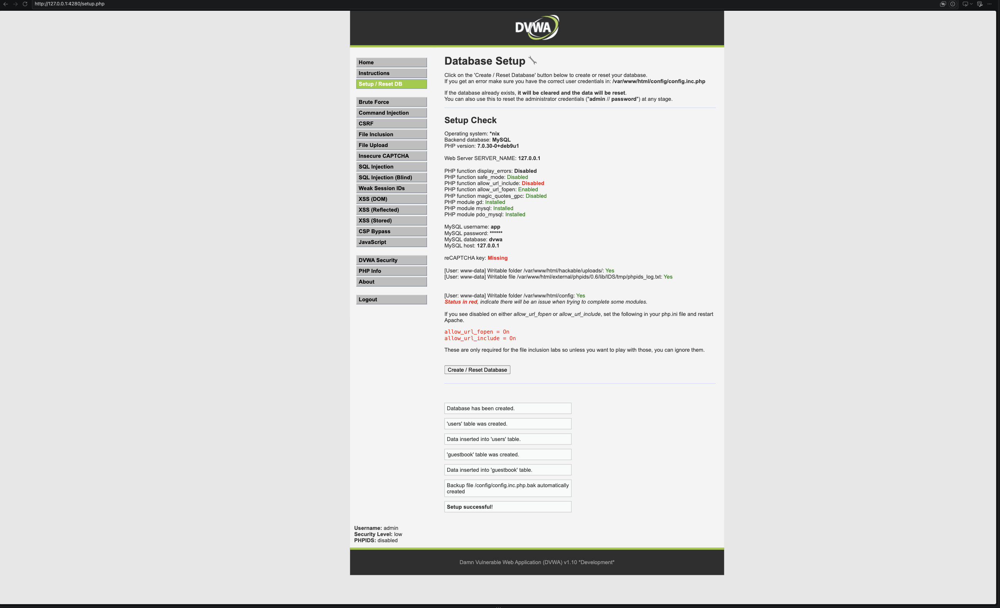

DVWA is running and logged in, with the security level set to Low. This is the vulnerable target and the starting point for every attack.

### 2. In-band always-true

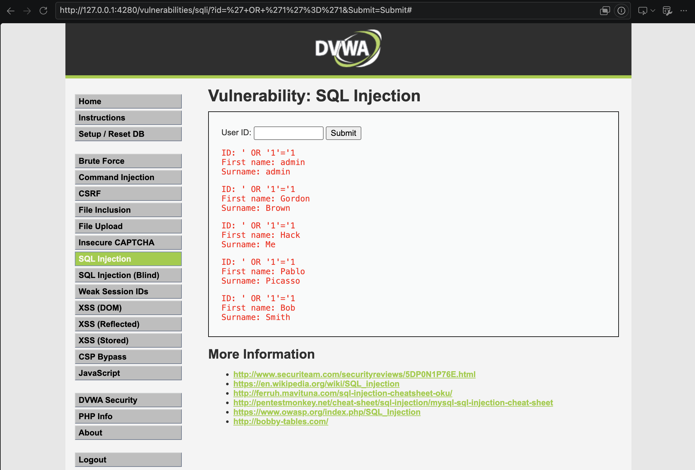

The payload `' OR '1'='1` closes the quote and adds a condition that is always true, so the query matches every row. Instead of one user, all five come back on the normal page.

### 3. UNION-based

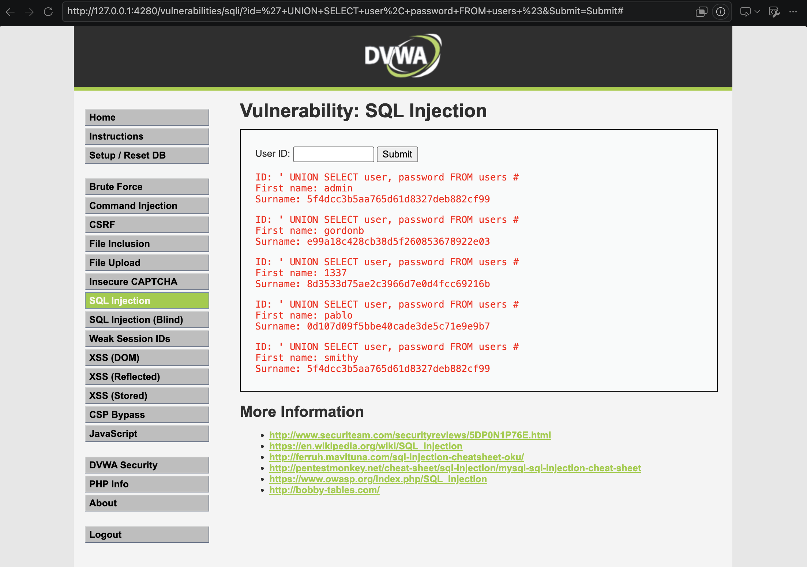

A UNION bolts a second query onto the first and pulls data from another table. Here it returns every username and password hash. The hashes are weak unsalted MD5, so they are easy to crack.

### 4. Error-based

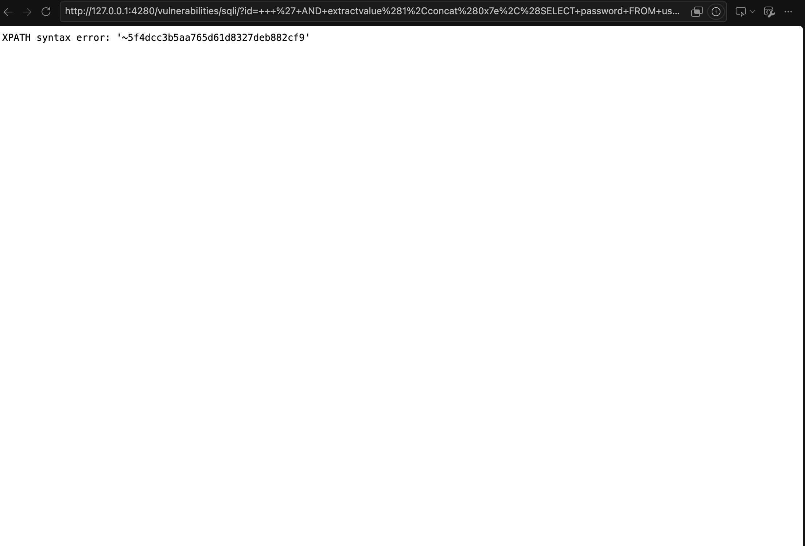

At Low security DVWA prints raw database errors. This attack forces an error on purpose, and the error text carries the stolen admin password hash back to the page.

### 5. Blind boolean (true)

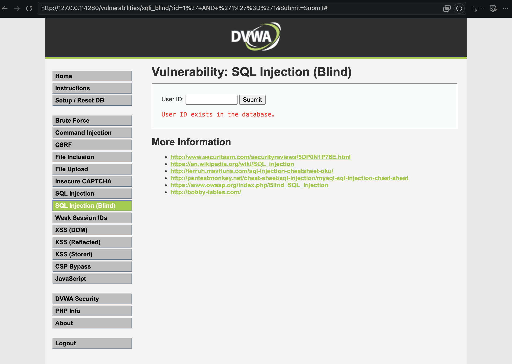

The blind page shows no data, only "User ID exists" or "User ID is MISSING". A true condition shows "exists". This proves the page reacts to a condition I control.

### 6. Blind boolean (false)

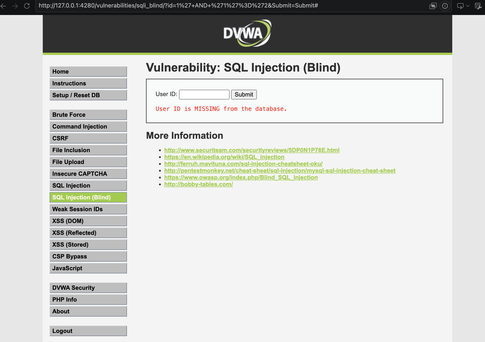

A false condition shows "missing". With a true and a false answer, I can ask yes/no questions and rebuild hidden data one character at a time.

### 7. Blind time-based

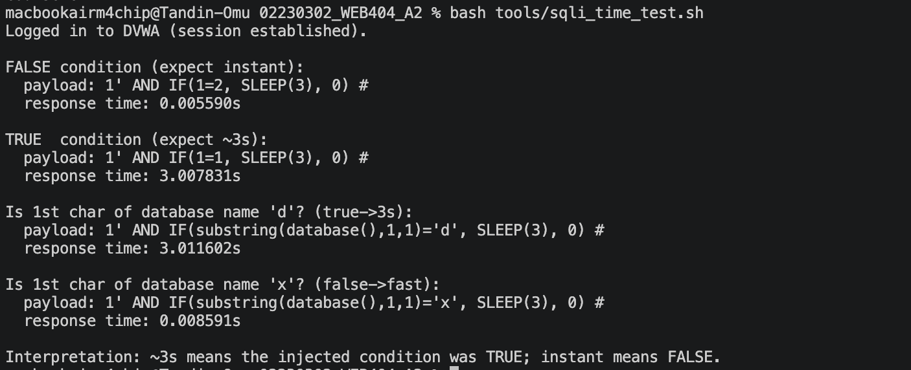

When the page text never changes, time is the signal. `SLEEP(3)` makes the database pause only when the answer is yes, so a slow reply means true and an instant reply means false. The terminal shows the timing clearly.

### 8. Medium and High levels

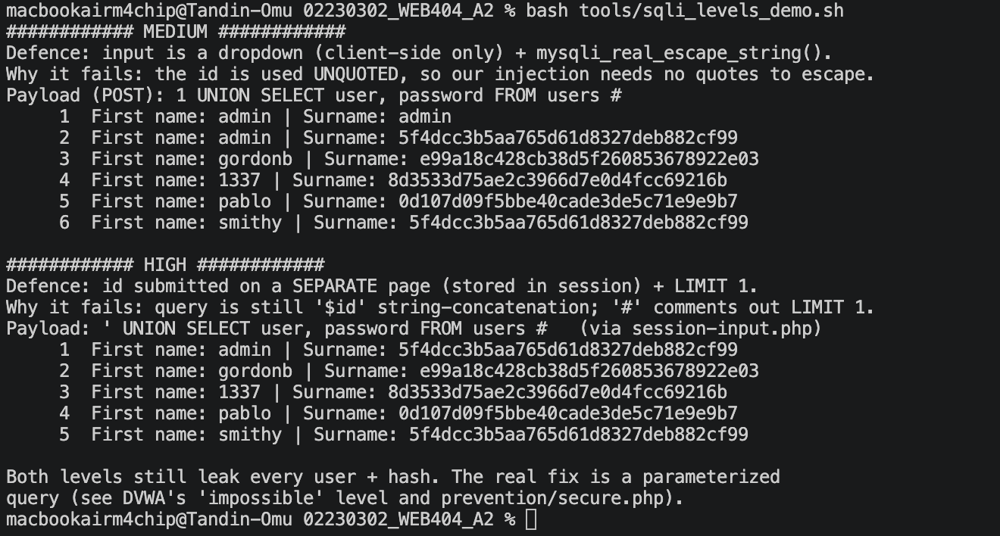

Medium and High add partial defences like quote-escaping and `LIMIT 1`, but the query is still built by gluing strings together. The attack is written differently but still leaks every hash. Only the "Impossible" level fixes the real cause.

### 9. sqlmap detects the flaw

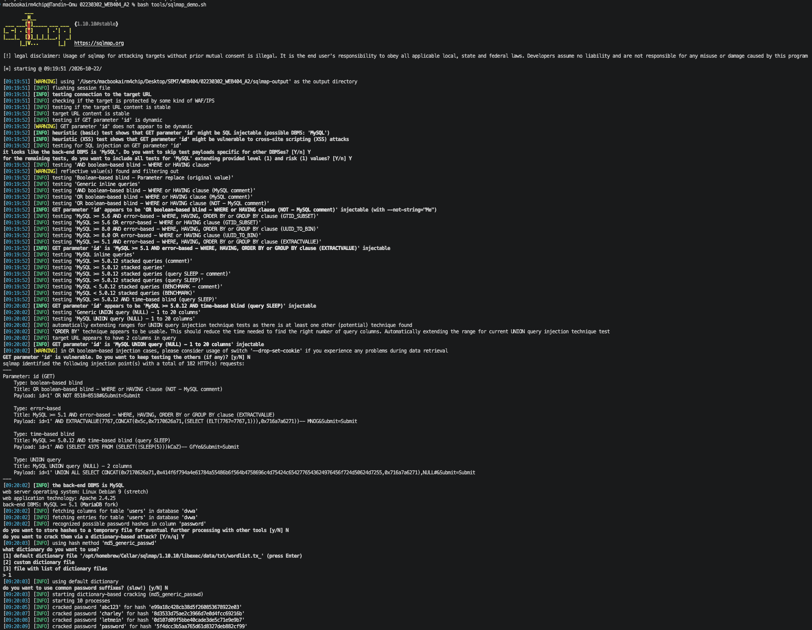

`sqlmap` is a standard tool that automates all of the above. Pointed at the page, it finds the `id` parameter is injectable and confirms the same techniques I did by hand.

### 10. sqlmap dumps the data

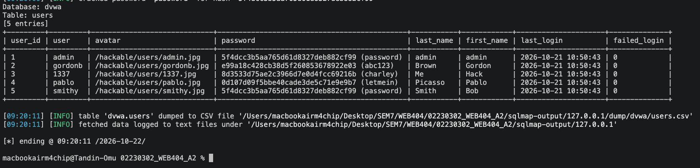

With one command, sqlmap dumps the whole users table and cracks the weak hashes into real passwords. This shows how fast and routine the attack is once one input is injectable.

### 11. The fix

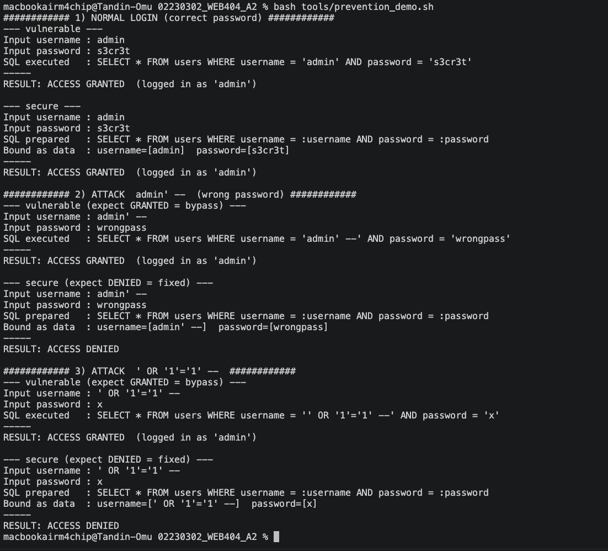

The fix is a parameterized query (a prepared statement), where the SQL uses a placeholder and the input is sent separately as data, so it can never run as code. The same attack input logs straight into `vulnerable.php` but is denied by `secure.php`.

---

## Conclusion

I showed five kinds of SQL injection, all caused by the same mistake: user input pasted straight into a SQL query. Raising DVWA's security level only changed how the attack was written, not whether it worked. The real fix is a parameterized query, which keeps code and data apart, and the secure demo proves the same attack then fails.

---

## Screenshots used (in order)

`01-dvwa-setup-low.png`, `02-inband-always-true.png`, `03-union-password-hashes.png`, `04-error-based-extractvalue.png`, `05a-blind-bool-true.png`, `05b-blind-bool-false.png`, `06-blind-time-based.png`, `07-medium-high-bypass.png`, `08a-sqlmap-detect.png`, `08b-sqlmap-dump.png`, `09-prevention-demo.png`.

---

## References

- OWASP Top 10:2021, A03 Injection: https://owasp.org/Top10/A03_2021-Injection/
- OWASP SQL Injection Prevention Cheat Sheet: https://cheatsheetseries.owasp.org/cheatsheets/SQL_Injection_Prevention_Cheat_Sheet.html
- CWE-89: Improper Neutralization of Special Elements used in an SQL Command: https://cwe.mitre.org/data/definitions/89.html
- DVWA (Damn Vulnerable Web Application): https://github.com/digininja/DVWA
- sqlmap: https://sqlmap.org/
